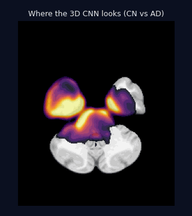
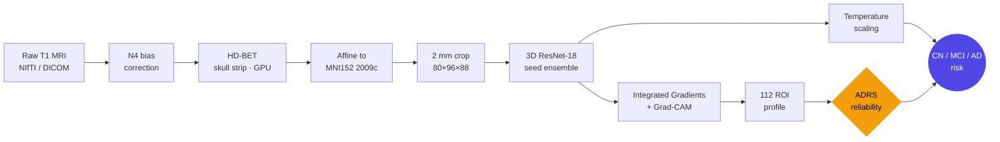
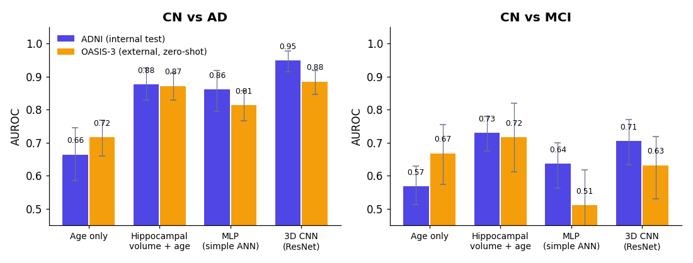
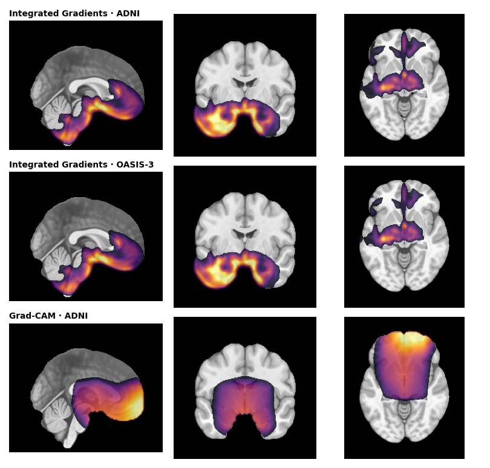

<div align="center">


<a href="#-quick-start"></a>

<p>


</p>



<sub><i>Group-mean Integrated Gradients for CN vs AD (ADNI test set) on the MNI152 template: the model concentrates on the medial temporal lobe.</i></sub>

</div>

---

## ✨ What this project does

Most Alzheimer's MRI classifiers report one accuracy on one dataset. This project asks the harder questions:

| | Question | How |
|---|---|---|
| 🧠 | **Can a 3D CNN detect AD and MCI from a T1 MRI?** | 3D ResNet-18 vs a simple ANN (MLP) vs age-only and hippocampal-volume baselines |
| 🌍 | **Does it still work on a different cohort?** | Train on **ADNI**, evaluate **zero-shot** on **OASIS-3** (different scanners, sites, population) |
| 🔍 | **Is it looking at the right anatomy?** | Integrated Gradients + Grad-CAM, aggregated to 112 Harvard-Oxford regions, compared across cohorts |
| 🛡️ | **Can we tell when a prediction should not be trusted?** | ADRS, an attribution-atypicality score, against MSP, energy, MC-dropout, ensembles, feature Mahalanobis |
| 🧩 | **Why does performance drop across cohorts?** | Shift decomposition: label definition → age/sex → field strength → residual |

All of it is wrapped in a **local web app**: drop in a NIfTI MRI and get a calibrated risk, a 3D explanation map and a reliability flag.

---

## 🏗️ Pipeline



**Protocol:**
- One scan per subject.
- Subject-level splits with leakage checks.
- OASIS-3 locked as an external test set: configs were frozen in [`docs/PROTOCOL.md`](docs/PROTOCOL.md) before any external evaluation.
- Thresholds and temperatures come from ADNI validation only.
- Bootstrap 95% CIs.

Every decision is logged in [`docs/DECISIONS.md`](docs/DECISIONS.md).

---

## 📊 Results (preliminary)

> Models were trained on the ~2,000 ADNI scans preprocessed so far, as a 2-seed ensemble. They were evaluated on the held-out ADNI test split and, zero-shot, on a stratified OASIS-3 subset, with clinical-diagnosis labels. Full-cohort runs are in progress.

<div align="center"></div>

| Task | Model | ADNI AUROC | ADNI accuracy | ADNI F1 | **OASIS-3 AUROC** (zero-shot) | OASIS-3 F1 |
|---|---|:-:|:-:|:-:|:-:|:-:|
| CN vs AD | Age only | 0.664 | 0.626 | 0.492 | 0.717 | 0.674 |
| CN vs AD | Hippocampal volume + age | 0.876 | 0.813 | 0.628 | 0.871 | 0.779 |
| CN vs AD | MLP (simple ANN) | 0.861 | 0.832 | 0.720 | 0.813 | 0.712 |
| CN vs AD | **3D ResNet ensemble** | **0.949** | **0.892** | **0.842** | **0.885** | **0.787** |
| CN vs MCI | Age only | 0.568 | 0.565 | 0.534 | 0.668 | 0.386 |
| CN vs MCI | Hippocampal volume + age | 0.730 | 0.658 | 0.679 | 0.716 | 0.390 |
| CN vs MCI | MLP (simple ANN) | 0.637 | 0.570 | 0.677 | 0.511 | 0.292 |
| CN vs MCI | **3D ResNet ensemble** | 0.705 | 0.641 | 0.585 | 0.632 | 0.343 |

**Takeaways so far**

- 🟢 **CN vs AD transfers well:** AUROC is 0.949 on ADNI and 0.885 on the unseen cohort, ahead of every baseline.
- 🟠 **CN vs MCI is the hard part:** the CNN does not yet beat hippocampal volume + age. It drops further on OASIS-3, where "MCI" is defined differently.
- 🔍 **Explanations are stable across cohorts:** for CN vs AD, the ADNI and OASIS-3 ROI attribution profiles correlate at Spearman ρ = 0.998. About 40% of the attribution mass falls in a-priori AD regions (hippocampus, amygdala, parahippocampal and temporal cortex).
- 🛡️ **Honest negative result:** in these preliminary runs ADRS does **not** detect errors better than plain softmax confidence. On OASIS-3 (CN vs AD), its error-detection AUROC is 0.55 against 0.69 for softmax confidence. This is reported as-is and will be re-tested on the full cohorts.

<details>
<summary><b>🧠 Explanation maps: Integrated Gradients vs Grad-CAM, ADNI vs OASIS-3</b></summary>
<br/>
<div align="center"></div>

These are group-mean maps on the MNI152NLin2009cAsym template, shown as sagittal, coronal and axial slices. The full maps are in `results/maps/` and on the app's Explainability page.
</details>

<details>
<summary><b>📁 Everything in <code>results/</code></b></summary>

| File / folder | Contents |
|---|---|
| `metrics.csv` | Accuracy, balanced accuracy, precision, recall, F1, AUROC and ECE with bootstrap CIs, per run × cohort × label definition × subset |
| `curves/`, `confusion/` | ROC / PR curves and confusion matrices |
| `training_curves/` | Per-epoch loss, accuracy and AUROC |
| `xai_stats.csv`, `roi_attribution/`, `maps/` | Cross-cohort explanation agreement, deletion faithfulness, randomization sanity check, ROI profiles and group-mean NIfTI maps |
| `reliability.csv`, `risk_coverage/` | Error-detection AUROC, AURC, and accuracy at 80/90% coverage for six reliability scores |
| `shift_decomposition.csv` | The ADNI → OASIS-3 drop, split into label, age/sex, field-strength and residual parts |
| `calibration/` | Ensemble checkpoints, temperatures, decision threshold and the ADRS reference (aggregate statistics only) |

Column specs are in [`results/CONTRACT.md`](results/CONTRACT.md). Subject-level predictions are never published.
</details>

---

## 🖥️ The app

<table>
<tr>
<td width="55%">

**Analyse scan**: upload a `.nii` / `.nii.gz` T1 MRI and the app:

1. preprocesses it with N4 → HD-BET → MNI registration (about 2 min on a 4 GB GPU),
2. runs the calibrated CN/AD and CN/MCI ensembles,
3. shows an interactive 3D viewer (NiiVue) with an **IG / Grad-CAM** overlay,
4. lists the top brain regions behind the decision,
5. flags the prediction as **reliable** or **review**, using ADRS.

The other pages:
- **Performance:** ROC, calibration, loss and accuracy curves, baselines.
- **Explainability**
- **Reliability**
- **Data**
- **About:** the roadmap.

</td>
<td>

```text
┌──────────────────────────────┐
│  CN vs AD        ▓▓▓▓▓▓▓░ 0.87│
│  → AD   reliable ✓            │
│  top: L hippocampus, R amyg.. │
├──────────────────────────────┤
│  CN vs MCI       ▓▓▓▓░░░ 0.58│
│  → MCI  review ⚠             │
├──────────────────────────────┤
│  [ 3D MRI + attribution map ] │
└──────────────────────────────┘
```

</td>
</tr>
</table>

Everything runs on `127.0.0.1`: there are no uploads, no telemetry and no cloud.

---

## 🚀 Quick start

**You need:**
- Windows 10/11
- Python 3.10
- an NVIDIA GPU with CUDA 12.8 drivers (4 GB is enough; CPU works but is slow)
- about 6 GB of disk

```powershell
git clone https://github.com/Rishab-RN/Early-Alzheimers-and-MCI-Detection.git
cd Early-Alzheimers-and-MCI-Detection
powershell -ExecutionPolicy Bypass -File setup.ps1     # venvs + template/atlas + HD-BET weights
.\run_dashboard.bat                                    # opens http://127.0.0.1:8000
```

The trained weights (`models/runs/`) and all aggregate results ship with the repo, so the app works right after setup. Upload any T1-weighted brain MRI in NIfTI format.

<details>
<summary><b>No GPU?</b></summary>

Set `ANN_APP_CPU=1` before starting the dashboard to force CPU inference. For a CPU-only install, edit `requirements.txt`: remove the `--extra-index-url` line and the `+cu128` suffixes.
</details>

<details>
<summary><b>Linux / macOS</b></summary>

```bash
python3.10 -m venv .venv-gpu && .venv-gpu/bin/pip install -r requirements.txt
python3.10 -m venv .venv-app && .venv-app/bin/pip install -r app/requirements.txt
.venv-gpu/bin/python src/fetch_references.py && .venv-gpu/bin/python download_hd_bet_weights.py
.venv-app/bin/python -m uvicorn app.server:app --host 127.0.0.1 --port 8000
```
</details>

---

## 🔬 Reproduce the research

The imaging data is **not** redistributable. Apply for free access yourself:

| Cohort | Role | Access |
|---|---|---|
| [ADNI](https://adni.loni.usc.edu/data-samples/access-data/) | train / validation / internal test | IDA account + data use agreement |
| [OASIS-3](https://sites.wustl.edu/oasisbrains/home/oasis-3/) | locked external test | NITRC-IR account + data use terms |
| [AIBL](https://aibl.org.au/) | second external test (planned) | via IDA |

```text
ADNI   : src/adni_select.py → src/fetch_urls.py → src/adni_convert.py
OASIS-3: python scripts/oasis3/start_background_download.py   (asks for your NITRC login)
Labels : src/labels_v2.py   → src/splits.py
Prep   : src/preprocess.py --manifest <csv>  (N4 → HD-BET → MNI affine, QC)
Cache  : src/cache_tensors.py
Train  : src/train.py --task cn_ad --seed 0 --res 2  (also mlp_baseline.py, baselines.py)
Eval   : src/evaluate.py      (frozen configs only, + BN-adapt / TENT)
XAI    : src/xai_reliability.py → src/shift_decomposition.py → src/make_paper_assets.py
```

`src/auto_pipeline.py` chains everything and resumes after interruptions. Set `ANN_RUN_PREFIX` to tag a set of runs.

<details>
<summary><b>🗂️ Repository layout</b></summary>

```text
├── app/                 FastAPI server + React/Vite frontend (prebuilt in app/web/dist)
├── src/                 preprocessing, training, evaluation, XAI, reliability, app engine
├── scripts/oasis3/      OASIS-3 downloader, labels and QC
├── models/runs/         trained 3D ResNet checkpoints (CN/AD, CN/MCI × 2 seeds)
├── results/             aggregate metrics, curves, maps, calibration
├── docs/                PROTOCOL.md (frozen configs), DECISIONS.md, README assets
├── journey.md           research log
├── setup.ps1            one-time setup
└── run_dashboard.bat    start the app
```
</details>

---

## 🗺️ Roadmap

- [x] Leakage-free ADNI + OASIS-3 pipeline with QC and three harmonised label definitions
- [x] 3D ResNet, MLP, age-only and hippocampal-volume baselines; loss and accuracy curves
- [x] Zero-shot external evaluation with bootstrap CIs; BN-adapt and TENT
- [x] Integrated Gradients + Grad-CAM, cross-cohort explanation comparison
- [x] ADRS reliability vs five baselines; shift decomposition
- [x] Local app: upload → risk → explanation → reliability
- [ ] Full-cohort training (all ADNI, 5 seeds) and full OASIS-3 evaluation
- [ ] MedicalNet transfer learning
- [ ] AIBL as a second external cohort
- [ ] Test-time augmentation; sMCI vs pMCI
- [ ] IEEE conference paper

---

## ⚠️ Disclaimer

**This is a research prototype, not a medical device.** It has not been clinically validated and must not be used for diagnosis or treatment decisions.

## 🙏 Acknowledgements

Data collection and sharing for this project was funded by the Alzheimer's Disease Neuroimaging Initiative (ADNI). Data were provided in part by OASIS-3 (principal investigators T. Benzinger, D. Marcus, J. Morris).

Built with [MONAI](https://monai.io), [HD-BET](https://github.com/MIC-DKFZ/HD-BET), [ANTsPy](https://github.com/ANTsX/ANTsPy), [Captum](https://captum.ai), [nilearn](https://nilearn.github.io), [TemplateFlow](https://www.templateflow.org) and [NiiVue](https://github.com/niivue/niivue).

This is a course project for *Artificial Neural Networks and Deep Learning* (AI2531A), B.Tech CSE (AI & ML), RV College of Engineering.


